<div align="center">


# Tempora

### Synthetic financial time series with a conditional Wasserstein GAN, and the tests that prove they're useful

[](https://github.com/Padu28/wgan-financial-timeseries/actions/workflows/ci.yml)
[](https://padu28.github.io/wgan-financial-timeseries/)


-EE4C2C)
[](LICENSE)

**[Open the live dashboard](https://padu28.github.io/wgan-financial-timeseries/)** &nbsp;|&nbsp; [Methodology](docs/methodology.md) &nbsp;|&nbsp; [Notebook](notebooks/wgan_financial_timeseries.ipynb) &nbsp;|&nbsp; [Model card](models/README.md)

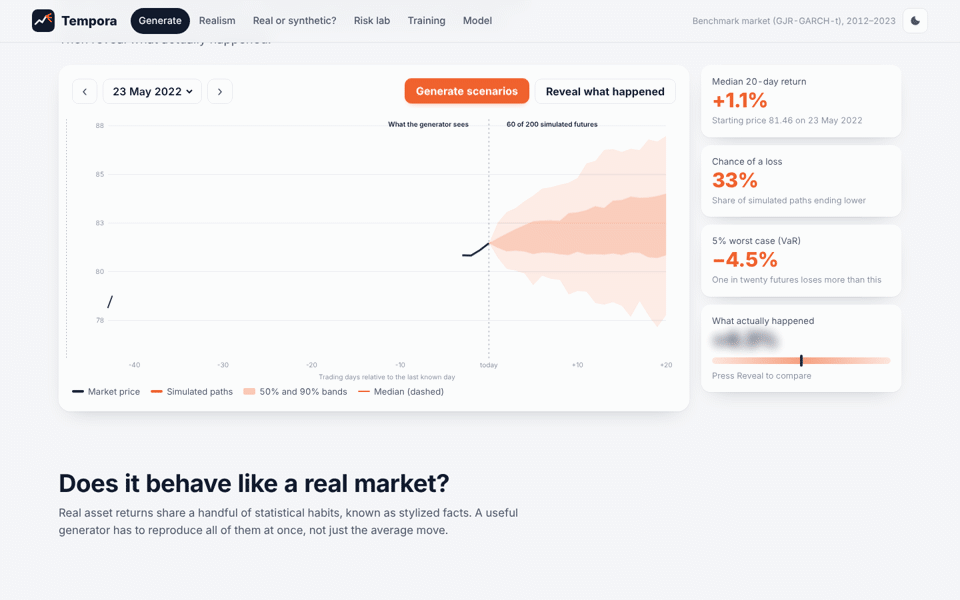

</div>

---

## Contents

- [Why synthetic market data](#why-synthetic-market-data)
- [Results at a glance](#results-at-a-glance)
- [What's new in version 2](#whats-new-in-version-2)
- [How it works](#how-it-works)
- [Dashboard guide](#dashboard-guide)
- [Quick start](#quick-start)
- [Train on real prices](#train-on-real-prices)
- [Python API](#python-api)
- [Project structure](#project-structure)
- [Testing and CI](#testing-and-ci)
- [Limitations and roadmap](#limitations-and-roadmap)
- [Credits and references](#credits-and-references)

## Why synthetic market data

Banks, asset managers and fintechs need far more market scenarios than history provides:

- **Stress testing and risk:** thousands of plausible futures to estimate value at risk and tail losses.
- **Model validation:** testing trading and risk models on data they haven't been fitted to.
- **Data sharing and privacy:** realistic data without exposing real positions or client flows.
- **Data augmentation:** more training examples for downstream machine-learning models.

Classical models such as GARCH capture some behaviour of returns; generative adversarial networks can learn the joint behaviour of a whole window directly from data. The hard part is proving the output is realistic, so this project puts as much weight on **evaluation** as on the model.

## Results at a glance

On the bundled benchmark market (3,000 days, model trained on the first 80%, tested on the last 20%):

| Check | Real | Synthetic | |
| --- | --- | --- | --- |
| Fat tails (excess kurtosis) | 14.7 | 12.8 | ✅ |
| No linear predictability (lag-1 autocorrelation) | 0.06 | 0.04 | ✅ |
| Volatility clustering (mean ACF of \|r\|, lags 1–5) | 0.29 | 0.17 | ✅ |
| Leverage effect (corr of r with future r²) | −0.14 | −0.05 | ✅ |
| Daily volatility | 1.02% | 1.07% | ✅ |
| 99% value at risk | 3.13% | 3.33% | ✅ |
| Negative skew | −1.22 | −0.66 | ✅ |

| Out-of-sample test | Result | Target |
| --- | --- | --- |
| 90% forecast interval contains the outcome | **92%** | 90% |
| 50% forecast interval contains the outcome | **52%** | 50% |
| 95% VaR breach rate | **6.0%** | 5% |
| Wasserstein-1 distance of return distributions | **0.041 × daily vol** | 0 |
| Classifier accuracy separating real from synthetic windows | 86% | 50% |

The last row is reported honestly: a strong classifier can still tell windows apart, which is the main open problem (see [roadmap](#limitations-and-roadmap)). Training takes **about 65 seconds on one CPU core**, with no GPU.

## What's new in version 2

| | Original thesis code | Version 2 |
| --- | --- | --- |
| Engine | PyTorch only, hard-coded absolute paths | Installable package and CLI. Dependency-light **NumPy engine with hand-derived, finite-difference-verified gradients**, plus an optional **PyTorch backend** of the same model |
| Generator | Dense network | Residual MLP with a **volatility head** (one latent factor scales the whole window) and a **tanh bound** that keeps outputs in the trained range |
| Gradient penalty | Batch-mean norm, one-sided | **Per-sample, two-sided**, as in Gulrajani et al. (2017) |
| Data | Local AAPL CSV | Simulated **GJR-GARCH-t benchmark**, loader for the original CSV and yfinance exports, one-command download of any ticker |
| Evaluation | Visual comparison of a few paths | **Stylized-fact scorecard**, Wasserstein/KS distances, QQ, **discriminative score**, PCA, **forecast coverage, PIT, CRPS, VaR backtest** on a held-out period |
| Output | Loss plots and PNGs | **Interactive dashboard**, CSV reports, model card, saved weights, scenario sampler |
| Engineering | None | Tests, linting, CI on three Python versions, automatic GitHub Pages deployment |

## How it works

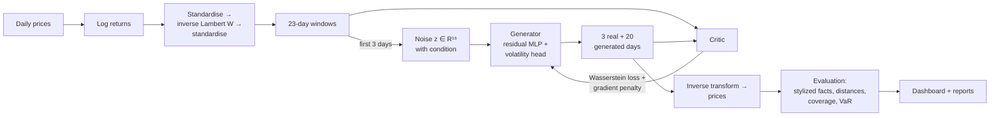

1. **Transform.** Log returns are standardised and passed through the inverse Lambert W transform, which turns heavy-tailed returns into a nearly Gaussian variable that a GAN learns much more easily. The transform is exactly invertible.
2. **Condition.** Each 23-day window is split into 3 known days and 20 days to generate. The known days are written into the first entries of the generator's noise vector.
3. **Train.** The critic learns to score real windows higher than generated ones while a **gradient penalty** keeps its gradient norm near 1 (the Lipschitz condition behind the Wasserstein distance). The generator learns to raise the critic's score of its windows. Learning rates follow the original project's triangular cycles.
4. **Generate.** For any 3-day context the generator draws as many 20-day continuations as you like, or chains windows into long synthetic histories.
5. **Evaluate.** Stylized facts, distribution distances and a classifier test check realism; coverage, PIT, CRPS and VaR breaches check calibration on data the model never saw.

Full details, formulas and limitations: [docs/methodology.md](docs/methodology.md).

## Dashboard guide

A single scrolling page with six sections; the bar at the top jumps between them and highlights where you are.

### 1. Generate: what could the next twenty days look like?

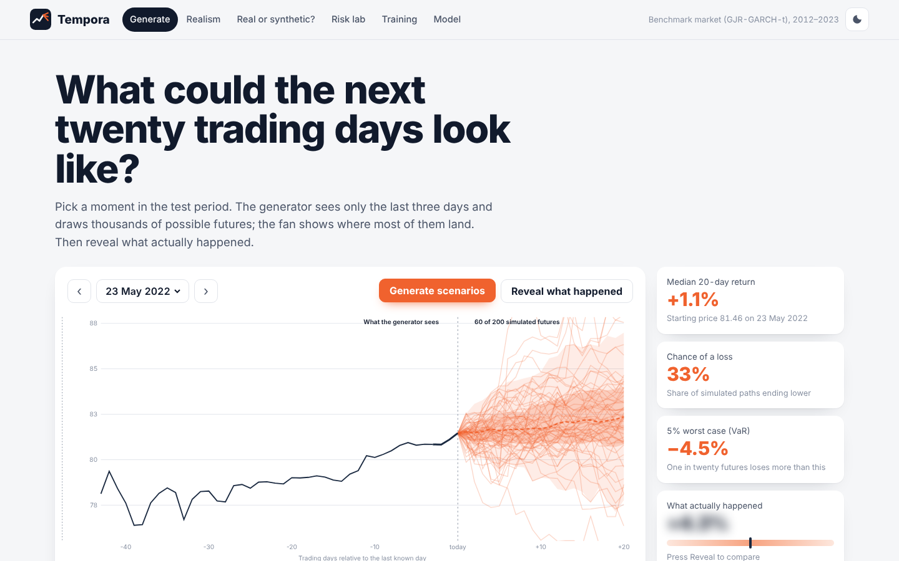

- **Pick a moment** in the test period with the date menu or the arrows (or <kbd>←</kbd> <kbd>→</kbd>).
- The **ink line** is the market price over the previous 40 days; the thick part is the 3 days the generator actually sees.
- **Generate scenarios** (or <kbd>G</kbd>) animates 60 of the 200 simulated futures, then the **50% and 90% bands** and the dashed **median** fade in. Hover the chart for the band at any day.
- The panel on the right summarises the simulations: median 20-day return, chance of a loss, and the 5% worst case (value at risk).

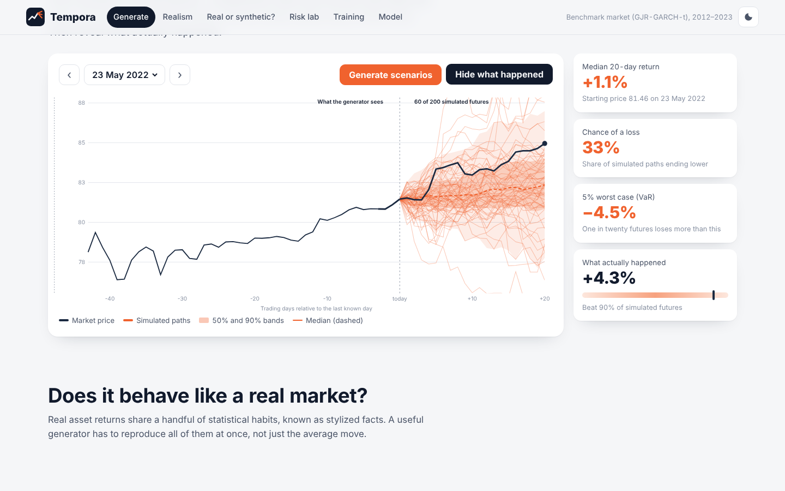

**Reveal what happened** (or <kbd>R</kbd>) draws the real path over the fan and shows where it ranked among the simulated futures. Over many moments, a calibrated generator should put the outcome inside the 90% band about 90% of the time.

### 2. Realism: does it behave like a real market?

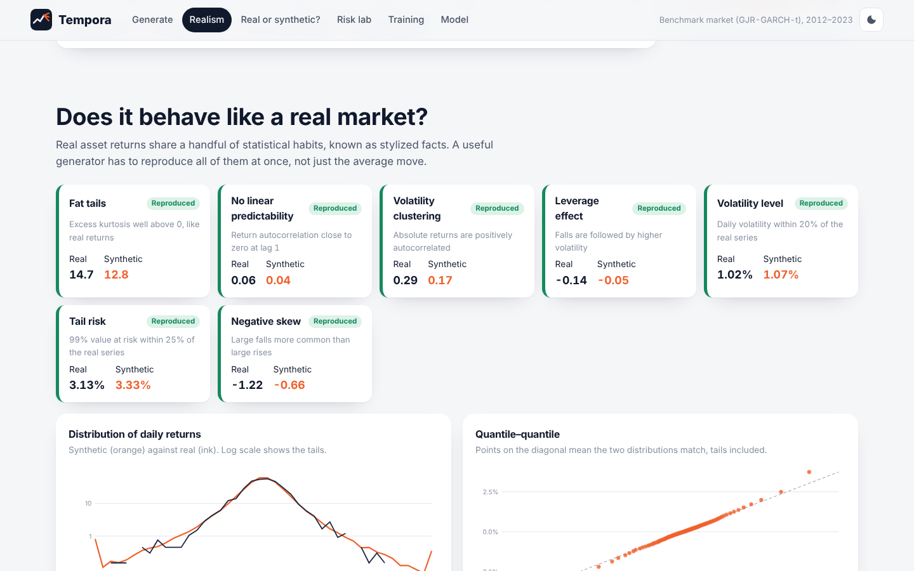

- **Scorecard.** Seven stylized facts of real returns, each marked *Reproduced* or *Missed*, with the real and synthetic value side by side.
- **Distribution of daily returns** on a log scale, so the tails are visible, and a **quantile–quantile** plot: points on the diagonal mean the distributions match.

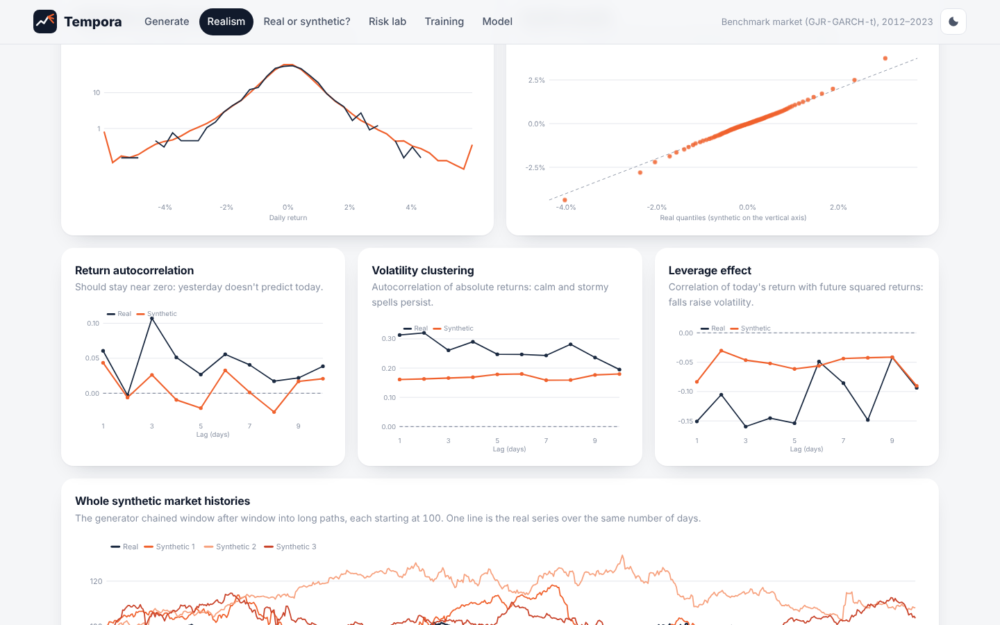

- **Return autocorrelation** should stay near zero. **Volatility clustering** (autocorrelation of absolute returns) should be clearly positive. The **leverage effect** (falls followed by higher volatility) shows as negative correlation.

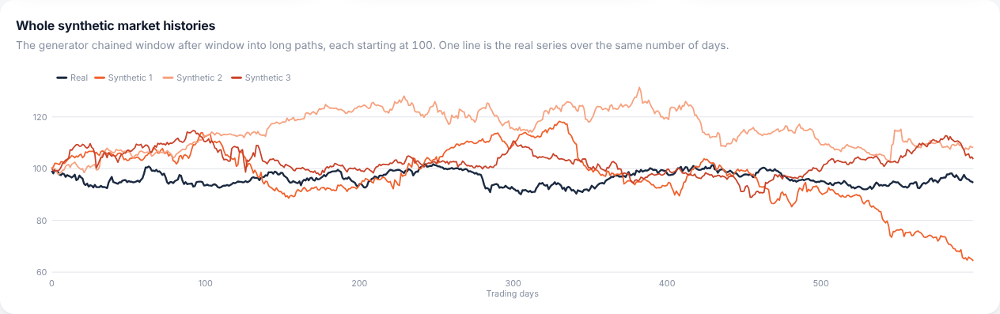

- **Whole synthetic market histories.** The generator chains window after window into long price paths. They wander, trend and crash like the real series (ink) without copying it.

### 3. Real or synthetic? A ten-round game

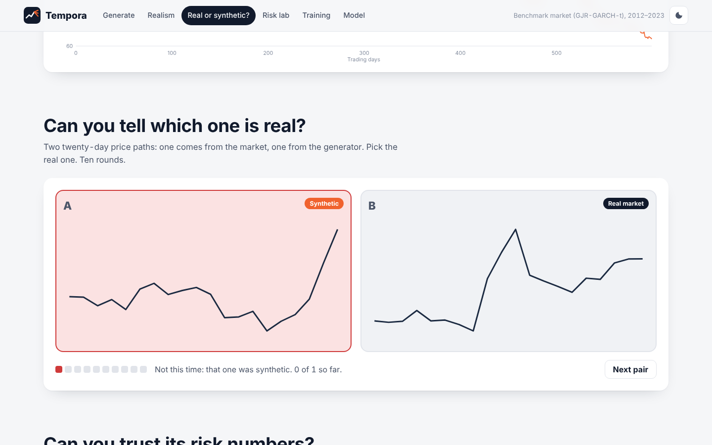

Two twenty-day paths: one real, one generated. Pick the real one (click, or <kbd>A</kbd> / <kbd>B</kbd>). The answer is revealed, the score bar fills, and after ten rounds you see how you did against chance. Scoring close to 5 of 10 means the generator fooled you.

### 4. Risk lab: can you trust its risk numbers?

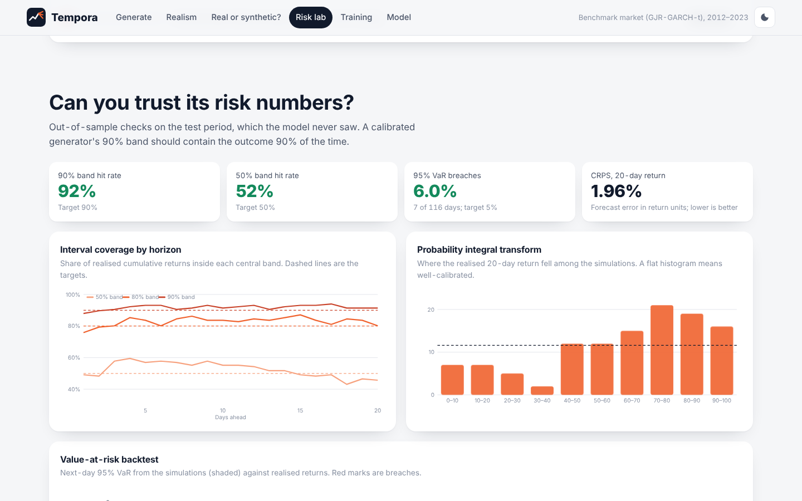

- **Headline checks:** hit rates of the 90% and 50% bands, the 95% VaR breach rate and the CRPS of 20-day forecasts, coloured green when on target.
- **Interval coverage by horizon:** for each day ahead, how often the real outcome fell inside each band; dashed lines are the targets.
- **Probability integral transform:** where the real 20-day return ranked among the simulations; a flat histogram means good calibration.

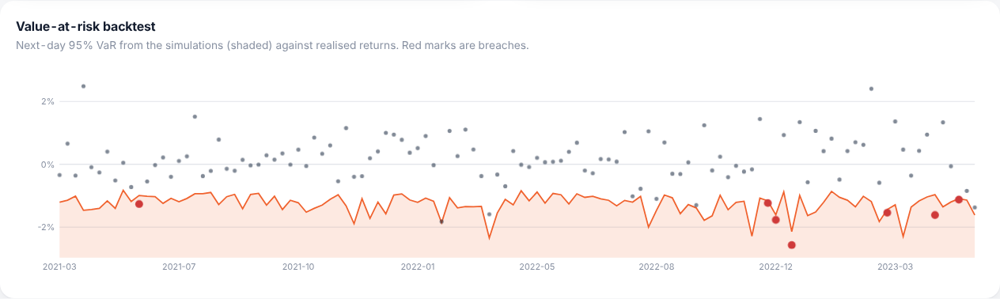

- **Value-at-risk backtest.** Next-day 95% VaR from the simulations (shaded) against what actually happened; red dots are breaches. Hover any day for details.

### 5. Training: watch it learn

<table>
<tr>
<td width="50%">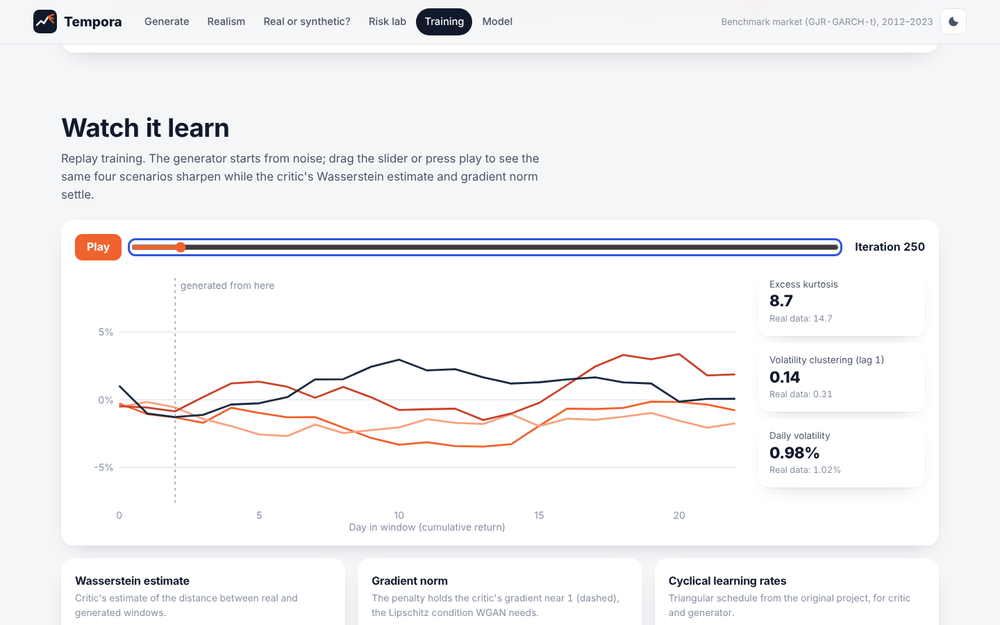</td>
<td width="50%">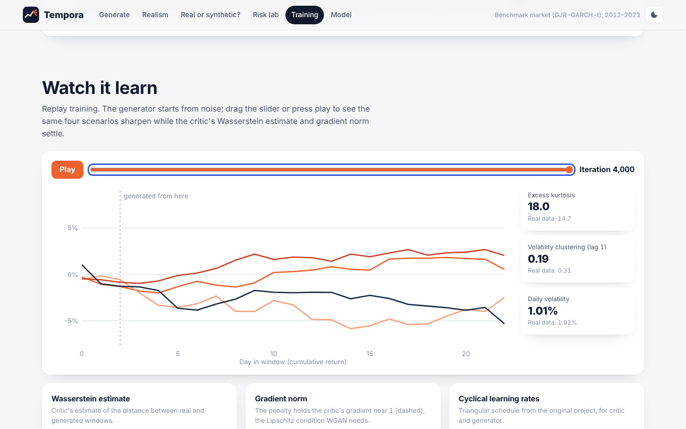</td>
</tr>
<tr><td>Early in training</td><td>After 4,000 iterations</td></tr>
</table>

Press **Play** or drag the slider to replay training. The same four scenarios are redrawn at each checkpoint, next to live kurtosis, volatility clustering and volatility compared with the real data. Below, the critic's **Wasserstein estimate**, the **gradient norm** (held near 1 by the penalty) and the **cyclical learning rates**.

### 6. Model: under the hood

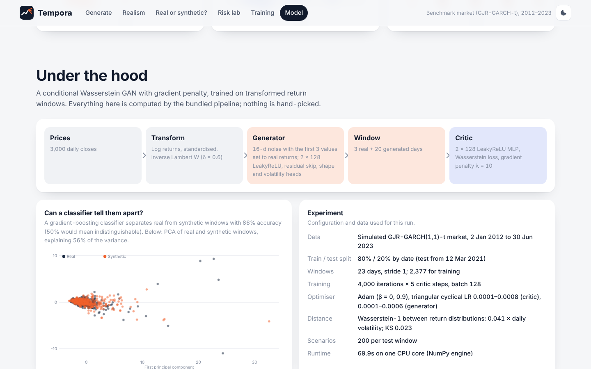

The pipeline from prices to critic, the **classifier test** with a PCA map of real and synthetic windows, and the full **experiment configuration**: data, split, windows, training, optimiser, distances and runtime.

### Dark theme and mobile

<table>
<tr>
<td width="66%">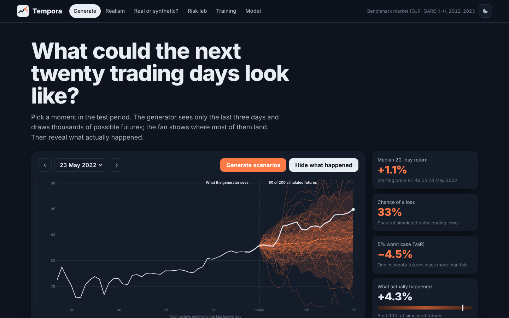</td>
<td width="34%">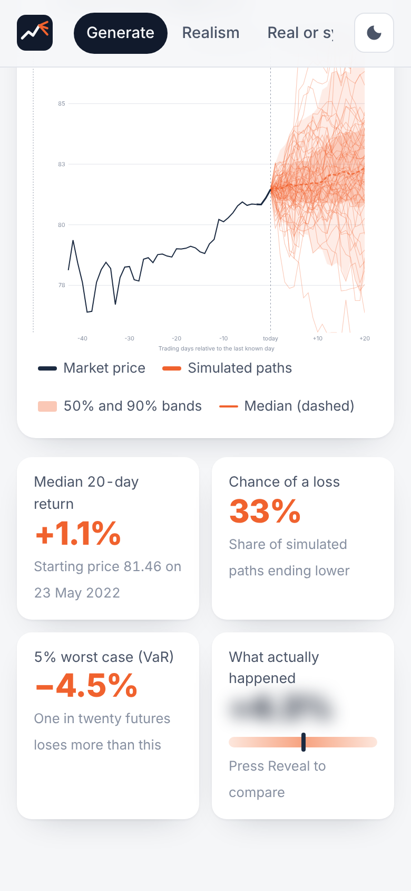</td>
</tr>
<tr><td>Dark theme: <kbd>T</kbd> or the moon button.</td><td>Phone layout.</td></tr>
</table>

| Key | Action |
| --- | --- |
| <kbd>G</kbd> | Generate scenarios |
| <kbd>R</kbd> | Reveal or hide what happened |
| <kbd>←</kbd> <kbd>→</kbd> | Previous or next moment |
| <kbd>A</kbd> <kbd>B</kbd> | Answer in the real-or-synthetic game |
| <kbd>T</kbd> | Switch theme |

The chosen moment is kept in the URL (`#m=19`), so you can share a specific scenario.

## Quick start

Requires Python 3.10 or newer. Core dependencies: NumPy, pandas, SciPy, scikit-learn. No GPU or PyTorch needed.

### Windows with VS Code

1. Download the code: `git clone https://github.com/Padu28/wgan-financial-timeseries.git`, or *Code > Download ZIP* and unzip it. Open the folder that contains `README.md`.
2. *Terminal > New Terminal*, then:
   ```powershell
   python -m venv .venv
   Set-ExecutionPolicy -Scope Process -ExecutionPolicy Bypass   # only if PowerShell blocks the next line
   .venv\Scripts\activate
   pip install -e ".[dev,notebook]"
   ```
3. Train and evaluate (about a minute). The realism checks and backtest results print in the terminal:
   ```powershell
   tempora train
   ```
4. Open the dashboard at **http://localhost:8000**, or double-click `dashboard/index.html`:
   ```powershell
   python -m http.server 8000 --bind 127.0.0.1 --directory dashboard
   ```

### macOS / Linux

```bash
git clone https://github.com/Padu28/wgan-financial-timeseries.git
cd wgan-financial-timeseries
python3 -m venv .venv && source .venv/bin/activate
pip install -e ".[dev,notebook]"
tempora train
python3 -m http.server 8000 --directory dashboard
```

<details>
<summary>Example output</summary>

```
Training WGAN-GP on 2,377 windows of 23 days (4,000 iterations)
  step  1000  W≈0.307  grad-norm 0.99
  step  2000  W≈0.456  grad-norm 1.00
  step  3000  W≈0.520  grad-norm 1.00
  step  4000  W≈0.585  grad-norm 1.01

Tempora  |  benchmark  |  2012-01-02 to 2023-06-30  |  65s

  Realism checks
    PASS  Fat tails                  real     14.7   synthetic     12.8
    PASS  No linear predictability   real     0.06   synthetic     0.04
    PASS  Volatility clustering      real     0.29   synthetic     0.17
    PASS  Leverage effect            real    -0.14   synthetic    -0.05
    PASS  Volatility level           real    1.02%   synthetic    1.07%
    PASS  Tail risk                  real    3.13%   synthetic    3.33%
    PASS  Negative skew              real    -1.22   synthetic    -0.66

  Discriminative accuracy   85.9%  (50% = indistinguishable)
  Wasserstein distance      0.041 × daily volatility
  Forecast interval hits    50% → 52%, 80% → 83%, 90% → 92%
  95% VaR breach rate       6.0%  (target 5%)
```
</details>

**Other commands**

```bash
tempora sample --paths 100 --days 250        # 100 synthetic one-year price paths -> CSV
tempora train --iterations 8000 --hidden 192 # bigger or longer runs
make help                                    # all shortcuts (Linux/macOS)
```

## Train on real prices

```bash
pip install yfinance
tempora data download --ticker AAPL --start 2010-01-01
tempora train --data data/raw/AAPL.csv --name aapl
```

The original project's `dataAPPL.csv` also works directly: `tempora train --data path/to/dataAPPL.csv --name aapl`.

**With a GPU** (optional), train the identical architecture in PyTorch and export it for the dashboard pipeline:

```bash
pip install torch
python -m tempora.torch_backend --data data/raw/AAPL.csv --iterations 10000
```

## Python API

```python
import tempora as tp

prices = tp.simulate_market()                  # or tp.load_prices("data/raw/AAPL.csv")
exp = tp.run(prices, tp.ExperimentConfig(gan=tp.GANConfig(iterations=4000)))

exp.results["scorecard"]                       # stylized-fact checks
exp.results["coverage"]["coverage"]            # forecast interval hit rates

# 500 possible next-20-day return paths after the last 3 known days
recent = exp.transform.transform(tp.transforms.log_returns(prices.to_numpy()))[-3:]
paths = exp.transform.inverse(exp.model.generate(recent, n_per=500)[:, 3:])

tp.export(exp)                                 # reports, weights and dashboard data
```

## Project structure

```
wgan-financial-timeseries/
├── src/tempora/
│   ├── gan.py            NumPy WGAN-GP: generator, critic, analytic gradients, Adam, cyclical LR
│   ├── torch_backend.py  same model in PyTorch, weight export to NumPy
│   ├── transforms.py     log returns, inverse Lambert W transform, windows
│   ├── metrics.py        stylized facts, distances, discriminative score, coverage, PIT, CRPS, VaR
│   ├── pipeline.py       train, evaluate, scenarios, reports and dashboard data
│   ├── data.py           CSV loader, yfinance download, GJR-GARCH-t benchmark
│   └── cli.py            `tempora data | train | sample`
├── dashboard/            interactive dashboard (HTML, CSS, JS; deployed to GitHub Pages)
├── models/               trained weights, transform and model card
├── data/                 benchmark prices and processed reports
├── notebooks/            step-by-step walkthrough
├── tests/                gradient checks, transforms, metrics, pipeline, CLI
├── docs/                 methodology, publishing guide, screenshots
└── .github/workflows/    CI and Pages deployment
```

## Testing and CI

```bash
pip install -e ".[dev]"
ruff check src tests
pytest
```

The tests include **finite-difference checks of every analytic gradient** (critic, input gradient, gradient penalty and generator), round-trip tests of the transform, loading the original CSV format, the benchmark's stylized facts, calibration of the coverage test on a known model, a short end-to-end training run and the CLI. The PyTorch test runs automatically when `torch` is installed and checks that both backends give identical outputs.

GitHub Actions runs linting, tests and a short training run on Python 3.10, 3.12 and 3.13. A second workflow publishes the dashboard to GitHub Pages.

## Limitations and roadmap

- The classifier test (86%) shows synthetic windows are still distinguishable; volatility clustering and the leverage effect are reproduced but weaker than in the data.
- Conditioning on 3 days captures the current volatility level, not longer regimes.
- The published results use a simulated benchmark; quality on a particular asset must be checked with the same evaluation.

Planned:
- [ ] Temporal architectures (TCN, LSTM, transformer) as generator and critic options
- [ ] Longer conditioning windows and macro or regime conditioning
- [ ] Signature-based and MMD evaluation metrics
- [ ] Multi-asset generation with cross-correlations
- [ ] Comparison against GARCH, block bootstrap and TimeGAN baselines

## Credits and references

**Original project.** This repository builds on the ideas of *WGAN Financial Time-Series* by **Casper Hogenboom**, a thesis on generating financial time series with GANs (Maastricht University, 2020). Version 2 keeps its core design (conditional WGAN-GP, inverse Lambert W preprocessing, 23-day windows with 3 conditioning days, cyclical learning rates) in a new implementation with the additions listed above.

**Rebuilt and maintained by** Padmashree Shah ([GitHub @Padu28](https://github.com/Padu28) · [Padmashreeshah@gmail.com](mailto:Padmashreeshah@gmail.com)). Code released under the [MIT License](LICENSE).

**References**
- Arjovsky, Chintala and Bottou (2017). *Wasserstein GAN.*
- Gulrajani, Ahmed, Arjovsky, Dumoulin and Courville (2017). *Improved Training of Wasserstein GANs.*
- Goerg (2015). *The Lambert Way to Gaussianize Heavy-Tailed Data with the Inverse of Tukey's h Transformation.*
- Wiese, Knobloch, Korn and Kretschmer (2020). *Quant GANs: Deep Generation of Financial Time Series.*
- Yoon, Jarrett and van der Schaar (2019). *Time-series Generative Adversarial Networks.*
- Cont (2001). *Empirical Properties of Asset Returns: Stylized Facts and Statistical Issues.*
- Glosten, Jagannathan and Runkle (1993). *On the Relation between the Expected Value and the Volatility of the Nominal Excess Return on Stocks* (GJR-GARCH).
- Smith (2017). *Cyclical Learning Rates for Training Neural Networks.*
